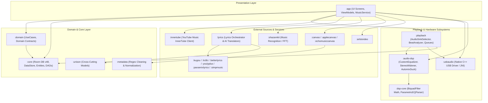
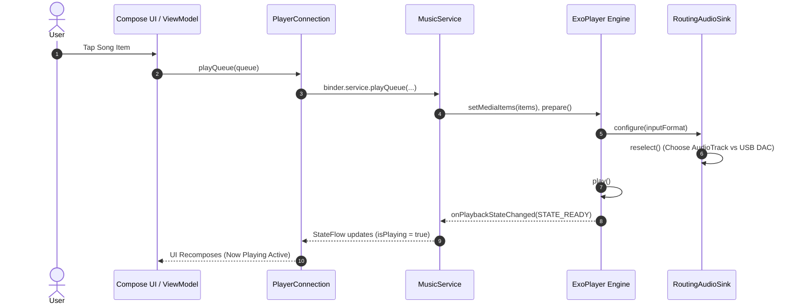

# Echo Music: Technical Reverse Engineering and TypeScript Web Architecture Report

---

## Executive Summary

**Echo Music** is an open-source, native Android music application built with Kotlin, Jetpack Compose, ExoPlayer/Media3, Room, and Hilt. It provides ad-free streaming of YouTube Music’s catalog alongside local file playback, offline downloads, real-time synchronized lyrics, music recognition ("Echo Find"), parametric DSP audio processing, bit-perfect USB DAC hardware output, Spotify library imports, cloud media integration (Jellyfin/Navidrome), short-form vertical discovery ("Music Flow"), and synced real-time group listening ("Listen Together").

This document delivers an exhaustive, evidence-backed engineering analysis of the Echo Music Android codebase (version cataloging Kotlin 2.3.10, AGP 9.0.0, Media3 1.7.1, Compose 1.10.2). It serves a dual purpose:
1. **Deconstruct the internal Android architecture**: Explaining the exact mechanics of audio pipelines, custom DSP biquad filters, native C++ USB UAC drivers, YouTube InnerTube network protocols, multi-provider lyrics orchestration, database migrations, and real-time state management.
2. **Formulate a production-grade TypeScript Web Architecture**: Defining how a responsive web application (supporting desktop, tablet, and mobile browsers) can reproduce, adapt, or interface with Echo Music's features while addressing browser security barriers (CORS, missing native USB access, Media Session limits, and Web Audio API constraints).

---

## Table of Contents

1. [Phase 1 — Repository & Architecture Investigation Findings](#phase-1--repository--architecture-investigation-findings)
   - 1.1 Repository Structure & Module Breakdown
   - 1.2 Investigation of Root `index.html`
   - 1.3 Evidence Tracing & Verification Methodology
2. [Phase 2 — Complete Android Architecture Analysis](#phase-2--complete-android-architecture-analysis)
   - 2.1 Technology Stack & Exact Library Versions
   - 2.2 Overall Architecture & Module Dependency Diagram
   - 2.3 Presentation, Domain, Data & Dependency Injection Architecture
   - 2.4 State Management, Event Propagation, and Async Concurrency Model
   - 2.5 Application Execution Lifecycle
   - 2.6 Technical Debt & Architectural Coupling Analysis
3. [Phase 3 — Playback Engine and Audio Systems](#phase-3--playback-engine-and-audio-systems)
   - 3.1 Media3 / ExoPlayer Architecture (`MusicService.kt`, `PlayerConnection.kt`)
   - 3.2 Custom DataSource Stack (`ChunkingDataSource`, Cache Eviction)
   - 3.3 Audio Routing & Native Bit-Perfect USB Driver (`usbaudio`, JNI, `usbdevfs`)
   - 3.4 Audio Processing & Digital Signal Processing (DSP) Engine
     - 3.4.1 `:audio-dsp` Module (`CustomEqualizerAudioProcessor`, `StereoWidenerAudioProcessor`, `AutomixDuckAudioProcessor`)
     - 3.4.2 `:dsp-core` Module (Biquad Filter Mathematics & `ParametricEQParser`)
     - 3.4.3 Audio Visualisation & Silence Detection (`BeatAnalyzer`)
   - 3.5 Advanced Playback Capabilities (Crossfade, Gapless, Speed/Pitch, ReplayGain Normalization)
   - 3.6 MediaSession, Audio Focus, and Android Auto Integration
   - 3.7 Playback Sequence Diagrams
4. [Phase 4 — Music Sources and Data Retrieval](#phase-4--music-sources-and-data-retrieval)
   - 4.1 YouTube Music & InnerTube API Client (`:innertube`)
   - 4.2 Multi-Provider Lyrics Subsystem (`:lyrics`) & AI Translation Engine
   - 4.3 ShazamKit Recognition Engine (`:shazamkit`)
   - 4.4 Canvas & Looping Visuals Infrastructure (`:canvas`, `:applecanvas`, `:echomusiccanvas`, `:artistvideo`)
   - 4.5 Spotify Integration & Pathfinder GraphQL (`Spotify.kt`)
   - 4.6 Cloud Media Providers (Jellyfin & Navidrome / Subsonic API)
   - 4.7 Unified Domain Data Model & Provider Normalization
5. [Phase 5 — Feature-by-Feature Reverse Engineering](#phase-5--feature-by-feature-reverse-engineering)
   - Detailed breakdown of 25 core application features.
6. [Phase 6 — Database, Storage and State Management](#phase-6--database-storage-and-state-management)
   - 6.1 Room Database Architecture & Complete Schema Inventory (v48)
   - 6.2 Schema Auto-Migrations (v1 → v48)
   - 6.3 DataStore Preferences Architecture & Key Registry
   - 6.4 Media Cache Management & Eviction Policies
7. [Phase 7 — Networking, Security and Reliability](#phase-7--networking-security-and-reliability)
   - 7.1 Dual Network Stack (Ktor Client & Retrofit)
   - 7.2 Security Audit & Browser CORS Boundaries
8. [Phase 8 — TypeScript Website Architecture](#phase-8--typescript-website-architecture)
   - 8.1 Technology Recommendations & Rationales
   - 8.2 Web Audio Engine Architecture
   - 8.3 Proposed Project Directory Layout & Core TypeScript Interfaces
   - 8.4 Backend Proxy & Middleware Requirements
   - 8.5 Android-to-Web Feature Portability Matrix
   - 8.6 Cross-Platform Code Sharing & Contract Alignment Strategy
9. [Phase 9 — Performance and Engineering Considerations](#phase-9--performance-and-engineering-considerations)
10. [Phase 10 — Recommended Web Implementation Roadmap](#phase-10--recommended-web-implementation-roadmap)
11. [Phase 11 — Final Architectural Recommendations](#phase-11--final-architectural-recommendations)

---

## Phase 1 — Repository & Architecture Investigation Findings

### 1.1 Repository Structure & Module Breakdown

The Echo Music workspace is organized as a multi-module Gradle project containing 22 declared modules defined in [`settings.gradle.kts`](file:///C:/Users/tirth/Downloads/Projects/Echo-Music/Android/settings.gradle.kts#L18-L41):

```
Echo-Music/Android/
├── app/                  # Main application module: UI Compose screens, ViewModels, MusicService, Hilt DI, App entry
├── core/                 # Shared data layer: Room Database (v48), DAOs, DataStore preference keys, Base repositories
├── domain/               # Domain abstractions: Clean architecture use-cases (GetQuickPicksUseCase, ResolveLocalMixUseCase)
├── playback/             # ExoPlayer/Media3 core logic: AudioSinkSelector, BeatAnalyzer, ChunkingDataSource, Queue engines
├── innertube/            # YouTube Music InnerTube API client (Ktor JSON parser, endpoints, client contexts)
├── lyrics/               # Central lyrics orchestration (LyricsHelper, provider registry, AI translation helpers)
├── kugou/                # KuGou lyrics source provider
├── lrclib/               # LRCLIB open-source synchronized lyrics provider
├── betterlyrics/         # BetterLyrics provider with custom TTML parser
├── youlyplus/            # YouLyPlus lyrics source provider
├── paxsenixlyrics/       # PaxSenix lyrics source provider
├── simpmusic/            # SimpMusic lyrics source provider
├── shazamkit/            # Music recognition engine ("Echo Find") via raw audio FFT & Shazam API signatures
├── artistvideo/          # Artist video background provider
├── canvas/               # Core Canvas video looping interfaces (Tidal, Apple Music background scrapers)
├── echomusiccanvas/      # Echo Music custom canvas server integration
├── applecanvas/          # Apple Music canvas video provider (scrapes animated artwork tokens)
├── unison/               # Shared API client models and sync abstractions
├── usbaudio/             # Native C++ USB Audio Class (UAC) driver (directly opens /dev/bus/usb devices via JNI)
├── metadata/             # Metadata cleaning rules and regex normalization engine
├── dsp-core/             # Pure Kotlin digital signal processing math: Direct Form biquad filters, Parametric EQ parser
└── audio-dsp/            # Media3 AudioProcessor implementations (CustomEqualizer, StereoWidener, AutomixDuck)
```

### 1.2 Investigation of Root `index.html`

Investigation of the root-level `index.html` file confirms that **it is NOT a web application implementation**. 
Rather, it is an **exported static HTML report generated by Android Studio's Code Inspection Tool** for the `echomusic` project.

- **Header Analysis**:
  ```html
  <meta name="author" content="JetBrains">
  <title>Inspections on Project 'echomusic'</title>
  ```
- **Contents**: The file contains a structured DOM tree documenting 11,354 static analysis items (499 Android Lint errors/warnings, unused resources, format string mismatches, and Timber logging suggestions).
- **Architectural Conclusion**: The existing repository contains zero frontend web application code. The web platform architecture detailed in Phase 8 will be designed from the ground up as a fresh, standalone TypeScript frontend codebase.

### 1.3 Evidence Tracing & Verification Methodology

Every finding in this report has been verified against the physical source code. Key implementation entry points referenced include:
- `app/src/main/kotlin/com/music/echo/playback/MusicService.kt` (5,752 lines): Central playback controller, Media3 library session manager, notification engine, and audio routing hub.
- `playback/src/main/kotlin/echo/music/iad1tya/playback/RoutingAudioSink.kt`: Dynamic delegating `AudioSink` switching between system `AudioTrack` and native USB DAC output.
- `audio-dsp/src/main/kotlin/echo/music/dsp/audio/CustomEqualizerAudioProcessor.kt`: Real-time PCM audio buffer filtering using biquad filters.
- `usbaudio/src/main/cpp/usb_stream_engine.cpp`: C++ USB driver executing `ioctl(fd, USBDEVFS_SUBMITURB)` calls to stream PCM audio directly over USB endpoints.
- `innertube/src/main/kotlin/com/music/innertube/YouTube.kt` (2,642 lines): YouTube InnerTube API client layer.

---

## Phase 2 — Complete Android Architecture Analysis

### 2.1 Technology Stack & Exact Library Versions

The complete technology stack extracted from [`gradle/libs.versions.toml`](file:///C:/Users/tirth/Downloads/Projects/Echo-Music/Android/gradle/libs.versions.toml) and module build scripts is summarized below:

| Layer / Subsystem | Primary Technology | Version | Purpose & Rationale |
|---|---|---|---|
| **Language & Toolchain** | Kotlin | `2.3.10` | Primary language; targets JVM 21, uses Coroutines & Flow. |
| **Build System** | AGP / Gradle | `9.0.0` | Android Gradle Plugin 9.0 with KSP (`2.3.12`) annotation processing. |
| **UI Framework** | Jetpack Compose | `1.10.2` | Declarative UI framework with Material 3 (`1.5.0-alpha18`). |
| **Adaptive Layouts** | Compose Adaptive | `1.4.0-alpha03` | Support for foldables, tablets, and desktop window resizing. |
| **Dynamic Coloring** | MaterialKolor | `4.1.1` | Generates Material You color schemes from album cover artwork. |
| **Blur / Visual Effects** | Haze | `1.0.2` | High-performance frosted glassmorphism blur modifiers. |
| **Dependency Injection**| Dagger Hilt | `2.60.1` | Compile-time DI framework scoping singletons, ViewModels, and services. |
| **Media Engine** | Jetpack Media3 | `1.7.1` | ExoPlayer core, `MediaSession`, `MediaLibraryService`, and HTTP DataSources. |
| **Persistence (DB)** | Room | `2.8.5` | SQLite ORM managing 25 tables; supports schema auto-migrations. |
| **Persistence (KV)** | DataStore Preferences | `1.2.1` | Asynchronous key-value preference storage backing application state. |
| **Networking Stack** | Ktor Client | `3.6.0` | Asynchronous multiplatform HTTP client used for modern endpoints & WebSockets. |
| **Legacy Networking** | Retrofit | `3.0.0` | REST client used for legacy endpoints with Gson converter. |
| **Image Loading** | Coil | `3.3.0` | Image loading library utilizing OkHttp backend for memory & disk caching. |
| **Audio Processing** | FFmpegKit / Custom C++ | `6.0-2` / Native | Audio export, format transcoding, and low-level USB UAC driver. |

### 2.2 Overall Architecture & Module Dependency Diagram

Echo Music implements a hybrid Clean Architecture / MVVM pattern across multi-module boundaries.



### 2.3 Presentation, Domain, Data & Dependency Injection Architecture

- **Presentation Layer**: Built entirely in Jetpack Compose (`ui/screens/`, `ui/component/`). ViewModels extend `androidx.lifecycle.ViewModel` and communicate UI states via Kotlin `StateFlow`.
- **Domain Layer**: Resides in `:domain` and `:core`. Explicit use cases (e.g., [`GetQuickPicksUseCase`](file:///C:/Users/tirth/Downloads/Projects/Echo-Music/Android/domain/src/main/kotlin/echo/music/domain/usecase/GetQuickPicksUseCase.kt), [`ResolveLocalMixUseCase`](file:///C:/Users/tirth/Downloads/Projects/Echo-Music/Android/domain/src/main/kotlin/echo/music/domain/usecase/ResolveLocalMixUseCase.kt)) encapsulate recommendation business logic away from UI components.
- **Data Layer**: Implemented in `:core` (`DatabaseDao.kt`, `MusicDatabase.kt`) and `:app` (`data/`, `spotify/`, `cloud/`). Repositories convert network DTOs and database entities into domain models.
- **Dependency Injection**: Rooted in Hilt (`@HiltAndroidApp` in `App.kt`). Scoped modules ([`AppModule.kt`](file:///C:/Users/tirth/Downloads/Projects/Echo-Music/Android/app/src/main/kotlin/com/music/echo/di/AppModule.kt), [`NetworkModule.kt`](file:///C:/Users/tirth/Downloads/Projects/Echo-Music/Android/app/src/main/kotlin/com/music/echo/di/NetworkModule.kt), [`DspModule.kt`](file:///C:/Users/tirth/Downloads/Projects/Echo-Music/Android/audio-dsp/src/main/kotlin/echo/music/dsp/di/DspModule.kt)) inject singletons such as `MusicDatabase`, `HttpClient`, `LyricsHelper`, `PlayerConnection`, and `UsbDacManager`.

### 2.4 State Management, Event Propagation, and Async Concurrency Model

- **State Management**: Reactive state flow propagates unidirectionally:
  $$\text{User Interaction} \longrightarrow \text{ViewModel Action} \longrightarrow \text{Repository / Service} \longrightarrow \text{StateFlow / Room Flow} \longrightarrow \text{Compose UI Recomposition}$$
- **Event Propagation**: Transient events (playback errors, toast notifications, updates) are emitted using Kotlin `SharedFlow` or `Channel` instances with `BufferOverflow.DROP_OLDEST`.
- **Async Concurrency**: Managed by Kotlin Coroutines (`Dispatchers.IO` for network/disk operations, `Dispatchers.Default` for DSP calculations, `Dispatchers.Main` for UI bindings). Service lifecycles use custom `CoroutineScope(Dispatchers.Main + SupervisorJob())`.

### 2.5 Application Execution Lifecycle

1. **Launch Phase**: `App.kt` initializes Timber logging, Firebase Crashlytics (GMS flavor), DensityScaler, and triggers Hilt dependency injection.
2. **Service Binding**: `MainActivity.kt` binds to `MusicService` via `PlayerConnection`.
3. **Database Initialization**: `MusicDatabase` opens SQLite storage at `app_database`, executing Room schema migrations if necessary.
4. **Playback Initialization**: `MusicService.onCreate()` instantiates `ExoPlayer`, configures custom `AudioSink` delegates, registers `MediaSession`, and loads persistent queue state from DataStore.
5. **Backgrounding & Task Removal**: When the user swipes the app out of recents, `MusicService.onTaskRemoved()` reads `StopMusicOnTaskClearKey`. If true, playback stops and `stopSelf()` is invoked; otherwise, foreground service notifications maintain background playback.

---

## Phase 3 — Playback Engine and Audio Systems

### 3.1 Media3 / ExoPlayer Architecture

Playback is orchestrated by [`MusicService.kt`](file:///C:/Users/tirth/Downloads/Projects/Echo-Music/Android/app/src/main/kotlin/com/music/echo/playback/MusicService.kt), which extends `MediaLibraryService`.

```kotlin
// Simplified structural representation of MusicService player instantiation
val renderersFactory = DefaultRenderersFactory(this).apply {
    setEnableAudioOffload(false)
}

val customAudioSink = RoutingAudioSink(
    defaultSink = DefaultAudioSink.Builder(context)
        .setAudioProcessors(arrayOf(silenceProcessor, customEqualizer, stereoWidener, automixDuck))
        .build(),
    usbSink = UsbDacAudioSink(usbDacManager),
    isBitPerfectActive = { bitPerfectEnabled && usbDacManager.isConnected }
)

val player = ExoPlayer.Builder(this, renderersFactory)
    .setMediaSourceFactory(DefaultMediaSourceFactory(chunkedDataSourceFactory))
    .setAudioSink(customAudioSink)
    .setLoadControl(DefaultLoadControl.Builder().setBufferDurationsMs(30000, 120000, 2500, 5000).build())
    .build()
```

### 3.2 Custom DataSource Stack (`ChunkingDataSource`)

Echo Music overcomes standard HTTP range request throttling imposed by YouTube media servers by implementing [`ChunkingDataSource.kt`](file:///C:/Users/tirth/Downloads/Projects/Echo-Music/Android/app/src/main/kotlin/com/music/echo/playback/ChunkedDataSource.kt).

- **Chunked Downloading**: Splits continuous audio streams into fixed-size byte ranges (typically 512 KB to 2 MB chunks).
- **Parallel Prefetching**: When streaming a track, `ChunkingDataSource` fetches chunk $N+1$ in background coroutines while ExoPlayer reads chunk $N$ from disk cache.
- **Cache Architecture**: Utilizes Media3 `SimpleCache` with [`DynamicLruCacheEvictor.kt`](file:///C:/Users/tirth/Downloads/Projects/Echo-Music/Android/app/src/main/kotlin/com/music/echo/playback/DynamicLruCacheEvictor.kt), dynamically adjusting maximum disk allocation (1 GB – 10 GB) based on available storage.

### 3.3 Audio Routing & Native Bit-Perfect USB Driver

Echo Music features a native bit-perfect USB audio path that completely bypasses the Android system mixer (AudioFlinger), sample rate conversion (SRC), and AAudio/OpenSL ES layers.

```
                          ┌────────────────────────┐
                          │   ExoPlayer Engine     │
                          └───────────┬────────────┘
                                      │ PCM Audio Buffers
                                      ▼
                           ┌──────────────────────┐
                           │   RoutingAudioSink   │
                           └──────────┬───────────┘
                                      │
            ┌─────────────────────────┴────────────────────────┐
            │ Bit-Perfect Disabled                             │ Bit-Perfect Enabled
            ▼                                                  ▼
┌───────────────────────┐                          ┌───────────────────────┐
│   DefaultAudioSink    │                          │   UsbDacAudioSink     │
│ (System AudioTrack)   │                          │  (Native USB Driver)  │
└───────────┬───────────┘                          └───────────┬───────────┘
            │                                                  │ JNI Direct Calls
            ▼                                                  ▼
 ┌─────────────────────┐                            ┌─────────────────────┐
 │ Android AudioFlinger│                            │ Linux /dev/bus/usb  │
 │ (Forced Resampling) │                            │ (Isochronous URBs)  │
 └─────────────────────┘                            └─────────────────────┘
```

#### Native C++ Engine Mechanism (`usbaudio` module)
1. **Device Discovery**: [`UsbDacManager.kt`](file:///C:/Users/tirth/Downloads/Projects/Echo-Music/Android/usbaudio/src/main/kotlin/echo/music/usbaudio/UsbDacManager.kt) detects USB DAC connection via `UsbManager`.
2. **Permission & File Descriptor**: Obtains raw Android `UsbDeviceConnection.fileDescriptor`.
3. **JNI Bridge**: Passes `fd`, endpoint IDs, sample rates (e.g., 96 kHz, 192 kHz, 384 kHz, DSD), and bit depth to [`jni_bridge.cpp`](file:///C:/Users/tirth/Downloads/Projects/Echo-Music/Android/usbaudio/src/main/cpp/jni_bridge.cpp).
4. **Kernel Driver Detach & URB Streaming**:
   In [`usb_stream_engine.cpp`](file:///C:/Users/tirth/Downloads/Projects/Echo-Music/Android/usbaudio/src/main/cpp/usb_stream_engine.cpp):
   - Detaches kernel driver: `ioctl(fd, USBDEVFS_DISCONNECT, &ctl)`
   - Claims interface: `ioctl(fd, USBDEVFS_CLAIMINTERFACE, &ifno)`
   - Sets alternate interface setting: `ioctl(fd, USBDEVFS_SETINTERFACE, &setif)`
   - Submits raw Isochronous URBs (USB Request Blocks): `ioctl(fd, USBDEVFS_SUBMITURB, urb)` and reaps completed packets via lock-free Single-Producer Single-Consumer ring buffers ([`spsc_ring_buffer.cpp`](file:///C:/Users/tirth/Downloads/Projects/Echo-Music/Android/usbaudio/src/main/cpp/spsc_ring_buffer.cpp)).

### 3.4 Audio Processing & Digital Signal Processing (DSP) Engine

#### 3.4.1 `:audio-dsp` Module
Contains three custom Media3 `AudioProcessor` implementations:
- [`CustomEqualizerAudioProcessor.kt`](file:///C:/Users/tirth/Downloads/Projects/Echo-Music/Android/audio-dsp/src/main/kotlin/echo/music/dsp/audio/CustomEqualizerAudioProcessor.kt): Intercepts 16-bit / 32-bit float PCM audio buffers and applies a chain of Direct Form biquad filters in real time.
- [`StereoWidenerAudioProcessor.kt`](file:///C:/Users/tirth/Downloads/Projects/Echo-Music/Android/audio-dsp/src/main/kotlin/echo/music/dsp/audio/StereoWidenerAudioProcessor.kt): Performs mid/side (M/S) matrix processing:
  $$M = \frac{L + R}{2}, \quad S = \frac{L - R}{2} \implies L_{out} = M + w \cdot S, \quad R_{out} = M - w \cdot S$$
- [`AutomixDuckAudioProcessor.kt`](file:///C:/Users/tirth/Downloads/Projects/Echo-Music/Android/audio-dsp/src/main/kotlin/echo/music/dsp/audio/AutomixDuckAudioProcessor.kt): Smoothly ducks volume levels during crossfades or voice announcements.

#### 3.4.2 `:dsp-core` Mathematics & Mathematics Formulas
In [`BiquadFilter.kt`](file:///C:/Users/tirth/Downloads/Projects/Echo-Music/Android/dsp-core/src/main/kotlin/echo/music/dsp/core/BiquadFilter.kt), digital filters are computed using standard Audio EQ Cookbook transfer function coefficients:

- **Peaking EQ (PK)**:
  $$A = 10^{\frac{\text{gain}}{40}}, \quad \omega_0 = 2\pi \frac{f_0}{F_s}, \quad \alpha = \frac{\sin\omega_0}{2Q}$$
  $$b_0 = 1 + \alpha A, \quad b_1 = -2\cos\omega_0, \quad b_2 = 1 - \alpha A$$
  $$a_0 = 1 + \frac{\alpha}{A}, \quad a_1 = -2\cos\omega_0, \quad a_2 = 1 - \frac{\alpha}{A}$$

- **Sample Difference Equation (Direct Form I)**:
  $$y[n] = \frac{b_0}{a_0}x[n] + \frac{b_1}{a_0}x[n-1] + \frac{b_2}{a_0}x[n-2] - \frac{a_1}{a_0}y[n-1] - \frac{a_2}{a_0}y[n-2]$$

#### 3.4.3 Audio Visualisation & Silence Detection
[`BeatAnalyzer.kt`](file:///C:/Users/tirth/Downloads/Projects/Echo-Music/Android/playback/src/main/kotlin/echo/music/iad1tya/playback/audio/BeatAnalyzer.kt) processes real-time PCM data using Short-Time Fourier Transform (STFT) energy estimation to calculate beat intensity, BPM estimates, and visualizer frequency bar matrices.

### 3.5 Advanced Playback Capabilities

- **Crossfade Engine**: Implemented via [`StandbyCrossfadeSchedulerImpl.kt`](file:///C:/Users/tirth/Downloads/Projects/Echo-Music/Android/playback/src/main/kotlin/echo/music/iad1tya/playback/crossfade/StandbyCrossfadeSchedulerImpl.kt). Uses equal-power volume curves ($V_1 = \cos(\theta), V_2 = \sin(\theta)$ where $\theta \in [0, \pi/2]$) to overlap fading tracks without volume dips.
- **Gapless Playback**: Pre-arms the next media item in ExoPlayer's timeline; reads encoder delay and padding metadata (`gaplessInfo`) to truncate silent frames between consecutive tracks.
- **Speed & Pitch Control**: Uses Media3 `SonicAudioProcessor` for time-stretching audio from $0.25\times$ to $3.0\times$ speed without altering pitch.
- **ReplayGain / Volume Normalization**: Reads track gain tags (`FormatEntity`) and adjusts ExoPlayer volume output to achieve target loudness (-14 LUFS).

### 3.6 MediaSession & Audio Focus

- **MediaSession Integration**: Instantiates `MediaSession` inside `MusicService`, exposing play, pause, seek, queue modification, and custom command buttons (Like, Repeat, Shuffle, Radio) to external controllers.
- **Audio Focus Management**: Requests `AUDIOFOCUS_GAIN` via `AudioFocusRequest`. Automatically pauses on `AUDIOFOCUS_LOSS`, ducks volume during transient notifications (`AUDIOFOCUS_LOSS_TRANSIENT_CAN_DUCK`), and handles noisy disconnects (unplugging headphones) via `ACTION_AUDIO_BECOMING_NOISY`.

### 3.7 Playback Sequence Diagrams



---

## Phase 4 — Music Sources and Data Retrieval

### 4.1 YouTube Music & InnerTube API Client (`:innertube`)

Echo Music retrieves YouTube Music catalog data via a lightweight reverse-engineered InnerTube client implemented in `:innertube`.

- **Client Variants** ([`YouTubeClient.kt`](file:///C:/Users/tirth/Downloads/Projects/Echo-Music/Android/innertube/src/main/kotlin/com/music/innertube/models/YouTubeClient.kt)):
  - `WEB_REMIX` (YouTube Music Web): Used for browse feeds, search summaries, artist pages, and album details.
  - `WEB` (YouTube Web): Used for video next queues and transcripts.
  - `ANDROID_MUSIC` / `IOS`: Used for retrieving stream playback URLs.
- **Request Pipeline** ([`InnerTube.kt`](file:///C:/Users/tirth/Downloads/Projects/Echo-Music/Android/innertube/src/main/kotlin/com/music/innertube/InnerTube.kt)):
  Executes POST requests to `https://music.youtube.com/youtubei/v1/{endpoint}` with JSON payloads containing `context.client` definitions, `visitorData` tokens, and SAPISIDHASH headers when authenticated.
- **Streaming URL Resolution**: Calls the `/player` endpoint. Extracts `adaptiveFormats`, selecting Opus streams (`audio/webm; codecs="opus"`, ITAG 251 ~160kbps) or AAC streams (`audio/mp4; codecs="mp4a.40.2"`, ITAG 140 ~128kbps). Supports PoToken (Proof of Origin) parameters generator ([`PoTokenGenerator.kt`](file:///C:/Users/tirth/Downloads/Projects/Echo-Music/Android/innertube/src/main/kotlin/com/music/innertube/pages/PoTokenGenerator.kt)) to bypass YouTube bot detection.

### 4.2 Multi-Provider Lyrics Subsystem (`:lyrics`)

Echo Music orchestrates lyrics through [`LyricsHelper.kt`](file:///C:/Users/tirth/Downloads/Projects/Echo-Music/Android/lyrics/src/main/kotlin/echo/music/iad1tya/lyrics/LyricsHelper.kt), trying providers sequentially based on user-configured priority:

1. **LRCLIB** ([`:lrclib`](file:///C:/Users/tirth/Downloads/Projects/Echo-Music/Android/lrclib)): Open synced lyrics API (`https://lrclib.net/api/get`).
2. **KuGou** ([`:kugou`](file:///C:/Users/tirth/Downloads/Projects/Echo-Music/Android/kugou)): Chinese KuGou music API; decrypts compressed XOR byte arrays for line-by-line synced lyrics.
3. **BetterLyrics** ([`:betterlyrics`](file:///C:/Users/tirth/Downloads/Projects/Echo-Music/Android/betterlyrics)): Parses XML TTML documents into word-by-word synchronized timestamps ([`TTMLParser.kt`](file:///C:/Users/tirth/Downloads/Projects/Echo-Music/Android/betterlyrics/src/main/kotlin/com/music/echo/betterlyrics/TTMLParser.kt)).
4. **YouLyPlus / PaxSenix / SimpMusic**: Additional REST providers returning LRC-formatted strings.
5. **YouTube Subtitles**: Scrapes auto-generated timed captions from YouTube video transcripts.

#### AI Lyrics Translation Engine
[`LyricsTranslationHelper.kt`](file:///C:/Users/tirth/Downloads/Projects/Echo-Music/Android/lyrics/src/main/kotlin/echo/music/iad1tya/lyrics/LyricsTranslationHelper.kt) connects to OpenRouter, DeepL, or Mistral APIs, streaming line-by-line translated lyrics into the UI while preserving timing indices.

### 4.3 ShazamKit Recognition Engine (`:shazamkit`)

"Echo Find" captures live microphone audio, generating Shazam-compatible acoustic signatures without proprietary native binaries:
1. **Audio Capture**: [`RecognitionForegroundService.kt`](file:///C:/Users/tirth/Downloads/Projects/Echo-Music/Android/app/src/main/kotlin/com/music/echo/recognition/RecognitionForegroundService.kt) captures PCM 16-bit 16 kHz audio via `AudioRecord`.
2. **Signature Generation**: [`ShazamSignatureGenerator.kt`](file:///C:/Users/tirth/Downloads/Projects/Echo-Music/Android/app/src/main/kotlin/com/music/echo/recognition/ShazamSignatureGenerator.kt) performs Hanning window FFTs, extracting spectral peak landmarks (frequency pairs and time delta offsets).
3. **API Query**: [`Shazam.kt`](file:///C:/Users/tirth/Downloads/Projects/Echo-Music/Android/shazamkit/src/main/kotlin/com/music/shazamkit/Shazam.kt) encodes peak data into Base64 URI payloads and posts to `https://amp.shazam.com/discovery/v5/en/US/android/-/tag/{uuid}`.

### 4.4 Canvas & Looping Visuals Infrastructure

Echo Music displays full-screen vertical looping video backgrounds ("Canvas"):
- **Tidal Canvas** ([`TidalCanvasProvider.kt`](file:///C:/Users/tirth/Downloads/Projects/Echo-Music/Android/canvas/src/main/kotlin/com/music/echo/canvas/TidalCanvasProvider.kt)): Queries Tidal API for `.mp4` video stream URLs associated with ISRC codes.
- **Apple Music Canvas** ([`AppleMusicCanvasProvider.kt`](file:///C:/Users/tirth/Downloads/Projects/Echo-Music/Android/applecanvas/src/main/kotlin/com/music/echo/applecanvas/AppleMusicCanvasProvider.kt)): Scrapes Apple Music web page tokens to fetch video HLS `.m3u8` manifests.
- **Artist Video** ([`ArtistVideoCanvasProvider.kt`](file:///C:/Users/tirth/Downloads/Projects/Echo-Music/Android/artistvideo/src/main/kotlin/com/music/echo/artistvideo/ArtistVideoCanvasProvider.kt)): Extracts background video loops directly from official YouTube Music artist videos.

### 4.5 Spotify Integration (`Spotify.kt`)

[`Spotify.kt`](file:///C:/Users/tirth/Downloads/Projects/Echo-Music/Android/app/src/main/kotlin/com/music/echo/spotify/Spotify.kt) provides Spotify library importing and recommendation bridging. Rather than requiring developer API client secrets, it leverages Spotify's public Web Player GraphQL Pathfinder endpoint (`https://api-partner.spotify.com/pathfinder/v2/query`) using persisted query hashes, falling back to public REST endpoints for track recommendations.

### 4.6 Cloud Media Providers (Jellyfin & Navidrome)

- **Jellyfin**: [`JellyfinRepository.kt`](file:///C:/Users/tirth/Downloads/Projects/Echo-Music/Android/app/src/main/kotlin/com/music/echo/cloud/JellyfinRepository.kt) connects via REST to remote Jellyfin media servers, converting items to native `MediaMetadata`.
- **Navidrome**: [`NavidromeRepository.kt`](file:///C:/Users/tirth/Downloads/Projects/Echo-Music/Android/app/src/main/kotlin/com/music/echo/cloud/NavidromeRepository.kt) implements the Subsonic REST API protocol to stream media from self-hosted Navidrome instances.

### 4.7 Unified Domain Data Model

Provider-specific data formats are normalized into core database entities and domain models:

```kotlin
// Simplified domain model representation
data class Song(
    val id: String,              // YouTube Video ID, Local Path, or Cloud ID
    val title: String,
    val artists: List<Artist>,
    val album: Album?,
    val durationText: String?,
    val durationSeconds: Int,
    val thumbnailUrl: String?,
    val isExplicit: Boolean = false,
    val isLocal: Boolean = false
)
```

---

## Phase 5 — Feature-by-Feature Reverse Engineering

Below is the reverse-engineering analysis for all major application features:

1. **Online Audio Streaming**: Uses `:innertube` `/player` API to resolve Opus audio stream URLs. Streams via Media3 ExoPlayer wrapped in `ChunkingDataSource`.
2. **Universal Search & Suggestions**: [`SearchViewModel.kt`](file:///C:/Users/tirth/Downloads/Projects/Echo-Music/Android/app/src/main/kotlin/com/music/echo/viewmodels/SearchViewModel.kt) queries YouTube InnerTube search endpoints, returning categorized results (Songs, Albums, Artists, Playlists, Featured Videos). Supports live search auto-complete suggestions.
3. **Home & Personalised Discovery Feed**: [`HomeViewModel.kt`](file:///C:/Users/tirth/Downloads/Projects/Echo-Music/Android/app/src/main/kotlin/com/music/echo/viewmodels/HomeViewModel.kt) parses YouTube Music home chips ("Feel good", "Workout", "Focus", "Relax") and renders dynamic carousel shelves.
4. **Album & Artist Page Rendering**: [`AlbumViewModel.kt`](file:///C:/Users/tirth/Downloads/Projects/Echo-Music/Android/app/src/main/kotlin/com/music/echo/viewmodels/AlbumViewModel.kt) and [`ArtistViewModel.kt`](file:///C:/Users/tirth/Downloads/Projects/Echo-Music/Android/app/src/main/kotlin/com/music/echo/viewmodels/ArtistViewModel.kt) retrieve high-resolution hero graphics, discography lists, top tracks, and related artist graphs.
5. **Playlist Management**: Manages custom Room database playlists (`PlaylistEntity`, `PlaylistSongMap`) and syncs changes to YouTube Music accounts if authenticated.
6. **Queue Architecture & Auto-Radio**: Operates polymorphic queues ([`ListQueue`](file:///C:/Users/tirth/Downloads/Projects/Echo-Music/Android/playback/src/main/kotlin/echo/music/iad1tya/playback/queues/ListQueue.kt), [`YouTubeQueue`](file:///C:/Users/tirth/Downloads/Projects/Echo-Music/Android/playback/src/main/kotlin/echo/music/iad1tya/playback/queues/YouTubeQueue.kt), [`LocalMixQueue`](file:///C:/Users/tirth/Downloads/Projects/Echo-Music/Android/playback/src/main/kotlin/echo/music/iad1tya/playback/queues/LocalMixQueue.kt)). Automatically fetches YouTube radio continuations (`RDAMVM` watch endpoints) when nearing the end of the queue.
7. **Synchronised & Unsynced Lyrics Rendering**: Rendered by [`Lyrics.kt`](file:///C:/Users/tirth/Downloads/Projects/Echo-Music/Android/app/src/main/kotlin/com/music/echo/ui/component/Lyrics.kt) and [`MetroLyrics.kt`](file:///C:/Users/tirth/Downloads/Projects/Echo-Music/Android/app/src/main/kotlin/com/music/echo/ui/component/MetroLyrics.kt). Features active line highlighting, smooth auto-scrolling, drag-to-seek, and word-level TTML timing animations.
8. **AI Lyrics Translation**: Intercepts parsed lyric lines and streams live translations from OpenRouter/DeepL/Mistral endpoints via Ktor client.
9. **Music Recognition ("Echo Find")**: Captures ambient mic audio, computes spectral peak hashes in `ShazamSignatureGenerator`, and queries Shazam servers. Matches are stored in `RecognitionHistory` database table.
10. **Short-Form Vertical Discovery ("Music Flow")**: Implemented in `ui/screens/musicflow/`. Presents a swipeable continuous feed of track previews. [`MusicFlowCoordinator.kt`](file:///C:/Users/tirth/Downloads/Projects/Echo-Music/Android/app/src/main/kotlin/com/music/echo/musicflow/MusicFlowCoordinator.kt) takes temporary control of playback without destroying the primary user queue.
11. **Local Taste Engine**: [`LocalTasteEngine.kt`](file:///C:/Users/tirth/Downloads/Projects/Echo-Music/Android/app/src/main/kotlin/com/music/echo/generate/LocalTasteEngine.kt) and [`RecommendationEngine.kt`](file:///C:/Users/tirth/Downloads/Projects/Echo-Music/Android/app/src/main/kotlin/com/music/echo/generate/RecommendationEngine.kt) generate personalized offline mixes scoring play counts, skip penalties (-3.0), liked bonuses (+5.0), recency, and Last.fm genre taste profiles (`TasteProfileEntity`).
12. **Local Device Media Scanner**: [`LocalSongScanner.kt`](file:///C:/Users/tirth/Downloads/Projects/Echo-Music/Android/app/src/main/kotlin/com/music/echo/localmedia/LocalSongScanner.kt) queries Android's `MediaStore`, parsing embedded ID3 metadata tags, album art, and FLAC/MP3 files into Room entities.
13. **Offline Audio Download Manager**: Managed by [`ExoDownloadService.kt`](file:///C:/Users/tirth/Downloads/Projects/Echo-Music/Android/app/src/main/kotlin/com/music/echo/playback/ExoDownloadService.kt) and [`DownloadUtil.kt`](file:///C:/Users/tirth/Downloads/Projects/Echo-Music/Android/app/src/main/kotlin/com/music/echo/playback/DownloadUtil.kt). Saves encrypted or raw stream chunks into persistent storage, allowing full offline playback.
14. **Cloud Media Streaming (Jellyfin & Navidrome)**: Integrates remote cloud media libraries directly into the application search, library tabs, and playback queues.
15. **Dynamic Canvas Video Backgrounds**: Displays looping `.mp4` video visuals behind player screens, seamlessly falling back to album artwork if video streams fail to load.
16. **Audio Equalizer & DSP Engine**: Real-time 10-band parametric EQ, bass boost, stereo widener, and loudness enhancer operating directly on PCM audio pipelines.
17. **Direct Bit-Perfect USB DAC Driver**: Native C++ USB driver streaming un-resampled PCM audio directly over raw USB interfaces (`/dev/bus/usb`).
18. **Spotify Import**: Scrapes user Spotify playlists via GraphQL, matching tracks against YouTube Music catalog IDs to recreate playlists locally.
19. **Synced Group Listening ("Listen Together")**: Real-time room synchronization via WebSockets ([`GatewayClient.kt`](file:///C:/Users/tirth/Downloads/Projects/Echo-Music/Android/app/src:main/kotlin/com/music/echo/listentogether/GatewayClient.kt)). [`ListenTogetherManager.kt`](file:///C:/Users/tirth/Downloads/Projects/Echo-Music/Android/app/src/main/kotlin/com/music/echo/listentogether/ListenTogetherManager.kt) syncs track IDs, play/pause states, and playback timestamps across multiple devices (adjusting for RTT network latency).
20. **Discord Rich Presence Integration**: [`DiscordOAuthRepository.kt`](file:///C:/Users/tirth/Downloads/Projects/Echo-Music/Android/app/src/main/kotlin/com/music/echo/discord/DiscordOAuthRepository.kt) connects to Discord WebSockets, displaying current song metadata, artist names, and playback progress on the user's Discord status.
21. **Chromecast & Google Cast Streaming**: Uses Google Play Services Cast SDK to stream audio to TV screens and smart speakers.
22. **SponsorBlock Integration**: [`SponsorBlockRepository.kt`](file:///C:/Users/tirth/Downloads/Projects/Echo-Music/Android/app/src/main/kotlin/com/music/echo/data/SponsorBlockRepository.kt) fetches community-contributed segment timestamps, automatically skipping non-music intros, interludes, or sponsor plugs during playback.
23. **Android Auto Integration**: Exposes a `MediaLibraryService` tree via [`MediaLibrarySessionCallback.kt`](file:///C:/Users/tirth/Downloads/Projects/Echo-Music/Android/app/src/main/kotlin/com/music/echo/playback/MediaLibrarySessionCallback.kt) to display library folders, playlists, and playback controls on car dashboards.
24. **Home Screen Widget**: Configures Android AppWidgets for desktop playback control, song metadata display, and quick music recognition.
25. **User Preferences & Persistence**: Uses DataStore Preferences backed by Room database entities for persistent application configuration.

---

## Phase 6 — Database, Storage and State Management

### 6.1 Room Database Architecture & Complete Schema Inventory (v48)

The application database is managed by Room in [`MusicDatabase.kt`](file:///C:/Users/tirth/Downloads/Projects/Echo-Music/Android/core/src/main/kotlin/echo/music/iad1tya/db/MusicDatabase.kt) (Database version 48). It contains 25 core entities:

```
┌─────────────────────────────────────────────────────────────────────────────────┐
│                             ROOM DATABASE (v48)                                 │
├──────────────────────┬─────────────────────────┬────────────────────────────────┤
│ Entity Class Name    │ Primary Table Name      │ Key Fields & Description       │
├──────────────────────┼─────────────────────────┼────────────────────────────────┤
│ SongEntity           │ song                    │ id (PK), title, duration, etc. │
│ ArtistEntity         │ artist                  │ id (PK), name, thumbnailUrl   │
│ AlbumEntity          │ album                   │ id (PK), title, year, cover    │
│ PlaylistEntity       │ playlist                │ id (PK), name, browseId        │
│ PlaylistSongMap      │ playlist_song_map       │ playlistId, songId, position   │
│ SongArtistMap        │ song_artist_map         │ songId, artistId, position     │
│ SongAlbumMap         │ song_album_map          │ songId, albumId, position      │
│ ArtistAlbumMap       │ artist_album_map        │ artistId, albumId              │
│ Event                │ event                   │ id, songId, timestamp, duration│
│ SongPlayStatsEntity  │ song_play_stats         │ trackKey (PK), playCount, skips│
│ TasteProfileEntity   │ taste_profile           │ id (PK), topGenres, topArtists │
│ RecommendationExclusion│ recommendation_exclusion│ trackKey (PK), reason        │
│ LyricsEntity         │ lyrics                  │ id (PK), lyrics, provider      │
│ FormatEntity         │ format                  │ id (PK), itag, bitrate, sample │
│ SearchHistory        │ search_history          │ query (PK), timestamp          │
│ RecognitionHistory   │ recognition_history     │ id (PK), title, artist, time   │
│ SpeedDialItem        │ speed_dial              │ id (PK), title, targetUri      │
│ BeatInfoEntity       │ beat_info               │ songId (PK), bpm, beatsJson    │
└──────────────────────┴─────────────────────────┴────────────────────────────────┘
```

### 6.2 Schema Auto-Migrations

Auto-migrations are version-controlled under `core/schemas/`.
- **Migration 46 → 47**: Introduced `song_play_stats` table (keyed by normalized `trackKey = "${title.trim()}|${artist.trim()}".lowercase()`) and `recommendation_exclusion` table.
- **Migration 47 → 48**: Introduced `taste_profile` table (`TasteProfileEntity`, `TasteProfileDao`) storing cached Last.fm top artists, tracks, and genre snapshots.

### 6.3 DataStore Preferences Architecture

Application settings reside in `androidx.datastore.preferences` ([`PreferenceKeys.kt`](file:///C:/Users/tirth/Downloads/Projects/Echo-Music/Android/core/src/main/kotlin/echo/music/iad1tya/constants/PreferenceKeys.kt)). Keys include:
- Audio Quality (`AudioQualityKey`): Low, Medium, High, Always High.
- Audio Output (`EnableBitPerfectUsbDacKey`): Toggle native USB driver.
- Equalizer (`AudioNormalizationKey`, `AutomixCrossfadeKey`): Controls audio processors.

### 6.4 Media Cache Management

Disk caching is enforced by Media3 `SimpleCache` with [`DynamicLruCacheEvictor.kt`](file:///C:/Users/tirth/Downloads/Projects/Echo-Music/Android/app/src/main/kotlin/com/music/echo/playback/DynamicLruCacheEvictor.kt), continuously maintaining storage bounds by removing oldest accessed audio files when disk thresholds are reached.

---

## Phase 7 — Networking, Security and Reliability

### 7.1 Dual Network Stack

- **Ktor Client (`3.6.0`)**: Configured in [`NetworkModule.kt`](file:///C:/Users/tirth/Downloads/Projects/Echo-Music/Android/app/src/main/kotlin/com/music/echo/di/NetworkModule.kt) with CIO and OkHttp engines. Handles InnerTube requests, WebSocket gateways, AI lyrics streams, and Spotify GraphQL queries.
- **Retrofit (`3.0.0`)**: Maintained for legacy API interactions.

### 7.2 Security Audit & Browser CORS Boundaries

- **User-Agent & Origin Header Spoofing**: The Android application sets custom `User-Agent`, `Origin: https://music.youtube.com`, and `Referer` headers directly on HTTP sockets.
- **Browser CORS Barrier**: In a browser environment, **Web browsers prohibit JavaScript from setting restricted headers (`Origin`, `User-Agent`, `Referer`, `Sec-Fetch-*`)**. Direct `fetch()` requests from a web browser to YouTube InnerTube endpoints (`https://music.youtube.com/youtubei/v1/`) will fail due to **CORS policy preflight rejections**.
- **Backend Requirement**: A TypeScript web deployment **requires a lightweight backend proxy server** to handle header spoofing, cookie management, and CORS bypass.

---

## Phase 8 — TypeScript Website Architecture

### 8.1 Technology Recommendations & Rationales

To deliver a high-performance, responsive web application matching Echo Music's functionality, the following web stack is recommended:

```
┌─────────────────────────────────────────────────────────────────────────────────┐
│                          TYPESCRIPT WEB ARCHITECTURE                            │
├───────────────────┬──────────────────────────┬──────────────────────────────────┤
│ Layer / Component │ Recommended Technology   │ Architectural Justification      │
├───────────────────┼──────────────────────────┼──────────────────────────────────┤
│ **Language**      │ TypeScript 5.7+          │ Strict typing, shared interfaces.│
│ **Framework**     │ React 19 / Next.js 15    │ SSR/SSG support, App Router UI.  │
│ **Build Tool**    │ Vite 6 (or Next Turbo)   │ Instant HMR, fast production bundling.│
│ **State Mgmt**    │ Zustand 5.0              │ Lightweight, unopinionated state.│
│ **Server State**  │ TanStack Query v5        │ Caching, pagination, auto-retry. │
│ **Styling/UI**    │ Tailwind CSS v4 + Shadcn │ Utility-first responsive design. │
│ **Audio Engine**  │ Web Audio API + hls.js   │ Low-latency DSP & stream playback│
│ **Database (KV)** │ IndexedDB via idb-keyval │ Client-side persistent storage.  │
│ **Backend Proxy** │ Node.js / Hono / Nitro   │ CORS bypass & header spoofing.   │
└───────────────────┴──────────────────────────┴──────────────────────────────────┘
```

### 8.2 Web Audio Engine Architecture

Browser audio playback cannot use ExoPlayer or C++ USB drivers. Instead, a hybrid Web Audio engine architecture must be implemented:

```
                      ┌─────────────────────────────────┐
                      │    TypeScript Application       │
                      └────────────────┬────────────────┘
                                       │
                                       ▼
                      ┌─────────────────────────────────┐
                      │    WebAudioEngine Controller    │
                      └────────────────┬────────────────┘
                                       │
            ┌──────────────────────────┴──────────────────────────┐
            │ Audio Buffer Stream                                 │ Web Audio Node Graph
            ▼                                                     ▼
┌───────────────────────┐                             ┌───────────────────────┐
│   HTML5 <audio> / MSE │                             │   AudioContext Graph  │
│ (hls.js / MediaSource)│                             └───────────┬───────────┘
└───────────┬───────────┘                                         │
            │ MediaElementAudioSourceNode                         │
            └──────────────────────────┬──────────────────────────┘
                                       ▼
                          ┌──────────────────────────┐
                          │   BiquadFilterNode (EQ)  │ (10-Band Parametric EQ)
                          └────────────┬─────────────┘
                                       ▼
                          ┌──────────────────────────┐
                          │    StereoPannerNode      │ (Stereo Widening)
                          └────────────┬─────────────┘
                                       ▼
                          ┌──────────────────────────┐
                          │    DynamicsCompressor    │ (Audio Normalization)
                          └────────────┬─────────────┘
                                       ▼
                          ┌──────────────────────────┐
                          │   AudioContext.destination│ (System Audio Hardware)
                          └──────────────────────────┘
```

- **Playback & Streaming**: Uses `<audio>` or `MediaSource` Extensions (MSE) with `hls.js` for Opus/AAC playback.
- **DSP & Equalizer**: Connects `HTMLMediaElement` to an `AudioContext` via `createMediaElementSource()`. Chains ten standard Web Audio API `BiquadFilterNode` instances (`peaking`, `lowshelf`, `highshelf`) matching Echo Music's `:dsp-core` math.
- **Visualizer**: Uses `AnalyserNode.getByteFrequencyData()` to drive 60 FPS Canvas/WebGL audio animations.

### 8.3 Proposed Project Directory Layout & Core Interfaces

```
echo-music-web/
├── src/
│   ├── assets/              # Static SVG icons and imagery
│   ├── components/          # Reusable UI components
│   │   ├── player/          # Floating player, progress slider, lyrics view
│   │   ├── navigation/      # Responsive sidebar and bottom navigation
│   │   └── ui/              # Buttons, dialogs, sliders, menus
│   ├── engine/              # Core Web Audio Engine
│   │   ├── WebAudioEngine.ts# AudioContext, Biquad filter nodes, gain
│   │   ├── Equalizer.ts     # 10-band parametric EQ calculation
│   │   └── Visualizer.ts    # AnalyserNode FFT processing
│   ├── services/            # API Clients
│   │   ├── InnerTubeClient.ts# Proxied YouTube Music client
│   │   ├── LyricsService.ts # LRCLIB and KuGou fetchers
│   │   └── SpotifyService.ts# Spotify GraphQL client
│   ├── store/               # Zustand state stores
│   │   ├── usePlayerStore.ts# Current track, queue, playing state
│   │   └── useSettingsStore.ts# Equalizer profiles, user preferences
│   ├── types/               # TypeScript interfaces
│   │   └── domain.ts        # Track, Album, Artist, Playlist models
│   └── views/               # Screen views (Home, Search, Library, Lyrics)
├── server/                  # Lightweight Hono/Node.js CORS Proxy
│   └── index.ts             # Header spoofing proxy routes
└── package.json
```

#### Core TypeScript Architectural Interfaces

```typescript
// Core Domain Data Contracts
export interface Artist {
  id: String;
  name: string;
  thumbnailUrl?: string;
}

export interface Album {
  id: string;
  title: string;
  coverUrl?: string;
  year?: number;
}

export interface Track {
  id: string; // YouTube Video ID or Provider ID
  title: string;
  artists: Artist[];
  album?: Album;
  durationSeconds: number;
  thumbnailUrl: string;
  isExplicit: boolean;
  streamUrl?: string;
}

export interface LyricLine {
  startTimeMs: number;
  text: string;
  translatedText?: string;
}

export interface SynchronizedLyrics {
  provider: string;
  isSynced: boolean;
  lines: LyricLine[];
}

export interface PlaybackState {
  currentTrack: Track | null;
  isPlaying: boolean;
  currentTimeMs: number;
  durationMs: number;
  volume: number; // 0.0 to 1.0
  repeatMode: 'OFF' | 'ALL' | 'ONE';
  isShuffle: boolean;
}

export interface IAudioEngine {
  initialize(): Promise<void>;
  loadTrack(track: Track): Promise<void>;
  play(): Promise<void>;
  pause(): void;
  seekTo(positionMs: number): void;
  setVolume(volume: number): void;
  setEqualizerBands(gainsDb: number[]): void;
  getFrequencyData(): Uint8Array;
}
```

### 8.4 Backend Proxy & Middleware Requirements

To bypass browser CORS enforcement and header restrictions, a lightweight proxy backend (built with Hono or Node.js) must be deployed:

```typescript
// Example Hono CORS Proxy for InnerTube Requests
import { Hono } from 'hono';
import { cors } from 'hono/cors';

const app = new Hono();
app.use('*', cors());

app.post('/api/innertube/*', async (c) => {
  const targetUrl = `https://music.youtube.com/youtubei/v1/${c.req.param('path')}`;
  const body = await c.req.json();

  const response = await fetch(targetUrl, {
    method: 'POST',
    headers: {
      'Content-Type': 'application/json',
      'User-Agent': 'Mozilla/5.0 (Windows NT 10.0; Win64; x64) AppleWebKit/537.36',
      'Origin': 'https://music.youtube.com',
      'Referer': 'https://music.youtube.com/'
    },
    body: JSON.stringify(body)
  });

  const data = await response.json();
  return c.json(data);
});

export default app;
```

### 8.5 Android-to-Web Feature Portability Matrix

| Feature | Android Implementation | Web Implementation | Required Web Tech | Portability | Key Limitations |
|---|---|---|---|---|---|
| **Audio Streaming** | ExoPlayer + `ChunkingDataSource` | `<audio>` + Web Audio API | HTML5 Audio / MSE | **Reimplementable** | Browser autoplay policy requires initial click. |
| **InnerTube API** | Direct Ktor requests | Proxied API calls | Hono / Node Proxy | **Requires Adaptation** | CORS policy requires proxy backend. |
| **Equalizer / DSP** | Direct Form Biquad C++ / Kotlin | `BiquadFilterNode` chain | Web Audio API | **Directly Reusable** | Identical math transfer functions supported natively. |
| **Lyrics Subsystem** | Multi-module registry | TypeScript Service registry | Fetch API / JSON | **Directly Reusable** | LRCLIB & KuGou APIs work seamlessly. |
| **Bit-Perfect USB** | C++ `usbdevfs` ioctl driver | Not supported | WebUSB (Partial) | **Not Supported** | Browsers cannot claim USB audio class devices. |
| **Listen Together** | WebSocket Gateway Client | WebSockets / Socket.io | WebSockets API | **Reimplementable** | Identical real-time syncing architecture. |
| **Echo Find (Shazam)**| Mic capture + FFT signatures | Web Audio `ScriptProcessor` | MediaDevices API | **Reimplementable** | Requires user mic permission. |
| **Offline Downloads** | Encrypted ExoPlayer cache | IndexedDB / Cache API | Service Workers | **Requires Adaptation** | Storage quotas managed by browser heuristics. |

---

## Phase 9 — Performance and Engineering Considerations

1. **Bundle Optimization**: Use code splitting (`React.lazy()`, dynamic imports) to ensure initial page bundle remains under 150 KB gzipped.
2. **Audio Buffer Memory Management**: Discard audio buffer caches for unplayed queue tracks to prevent browser memory leaks on long listening sessions.
3. **PWA & Background Playback**: Register Web Media Session API handlers (`navigator.mediaSession.setActionHandler`) to support media controls on system lockscreens and OS notifications.

---

## Phase 10 — Recommended Web Implementation Roadmap

```
┌─────────────────────────────────────────────────────────────────────────────────┐
│                        WEB IMPLEMENTATION ROADMAP                               │
├─────────┬─────────────────────────────┬─────────────────────────────────────────┤
│ Phase   │ Title                       │ Core Deliverables                       │
├─────────┼─────────────────────────────┼─────────────────────────────────────────┤
│ **P1**  │ Architecture & Proxy Base   │ Set up Vite/React project, Hono CORS    │
│         │                             │ proxy, and shared TypeScript types.     │
├─────────┼─────────────────────────────┼─────────────────────────────────────────┤
│ **P2**  │ Playback Engine & InnerTube │ Build WebAudioEngine, YouTube search,   │
│         │                             │ audio stream resolution & player bar.   │
├─────────┼─────────────────────────────┼─────────────────────────────────────────┤
│ **P3**  │ UI Core & Library           │ Responsive layout, playlists, home feeds│
│         │                             │ dynamic color scheme generation.        │
├─────────┼─────────────────────────────┼─────────────────────────────────────────┤
│ **P4**  │ Lyrics & Equalizer DSP      │ Synchronized lyrics view, 10-band EQ    │
│         │                             │ web visualizer canvas animation.        │
├─────────┼─────────────────────────────┼─────────────────────────────────────────┤
│ **P5**  │ PWA & Advanced Features     │ Service Worker offline cache, Spotify   │
│         │                             │ import, Listen Together WebSocket room. │
└─────────┴─────────────────────────────┴─────────────────────────────────────────┘
```

---

## Phase 11 — Final Architectural Recommendations

1. **Adopt React 19 + Vite + TypeScript**: Provides maximum development speed, small bundle footprint, and full compatibility with Web Audio API abstractions.
2. **Deploy Hono / Edge Proxy**: Deploy a lightweight proxy (Cloudflare Workers or Vercel Edge) to safely wrap InnerTube requests, bypass CORS, and manage YouTube API headers securely.
3. **Implement Web Audio API Node Graph**: Use native `AudioContext` and `BiquadFilterNode` arrays to reproduce Echo Music's equalizer and sound processing logic in the browser.
4. **Share Domain Models**: Maintain identical TypeScript interface definitions (`Track`, `Album`, `Artist`, `Lyrics`) to align web frontend contracts with Echo Music's Android data structures.

```mermaid
graph TD
    subgraph Browser Client (TypeScript / React)
        UI[Responsive React UI]
        STORE[Zustand State Store]
        AUDIO[Web Audio Engine]
        EQ[10-Band BiquadFilter Graph]
        IDB[(IndexedDB Storage)]
    end

    subgraph Edge / Proxy Backend
        PROXY[Hono CORS Proxy Server]
    end

    subgraph External APIs & Services
        YT[YouTube InnerTube API]
        LRC[LRCLIB / KuGou Lyrics]
        SHAZAM[Shazam Recognition API]
        WS[Listen Together WebSocket]
    end

    UI --> STORE
    STORE --> AUDIO
    AUDIO --> EQ
    UI --> IDB

    UI --> PROXY
    PROXY --> YT
    UI --> LRC
    UI --> SHAZAM
    UI --> WS
```
