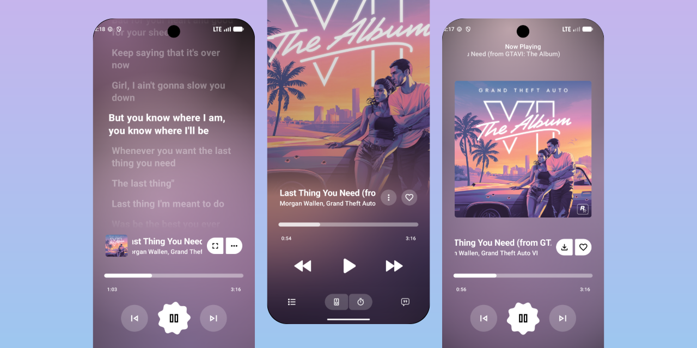

<div align="center">
  

  <p><b>A modern web and Android music app with ad-free streaming, synced lyrics, offline playback, and an intuitive user experience.</b></p>
</div>

---

# Echo Music Web

### Stream and discover ad-free music everywhere.

**Echo Music Web** is the companion web client to [Echo Music for Android](https://github.com/EchoMusicApp/Echo-Music).

Built with React and TypeScript, Echo provides a full-featured music browsing and playback experience powered by real Web Audio DSP, a local Hono-based audio proxy server, persistent Dexie IndexedDB storage, and extensive integrations.

---

## Contents

- [Vision](#vision)
- [Project goals](#project-goals)
- [Relationship with Echo Android](#relationship-with-echo-android)
- [Technology stack](#technology-stack)
- [Architecture](#architecture)
- [Implemented features](#implemented-features)
- [Design philosophy](#design-philosophy)
- [Browser capabilities](#browser-capabilities)
- [Development environment](#development-environment)
- [Getting started](#getting-started)
- [Available commands](#available-commands)
- [Project structure](#project-structure)
- [Engineering principles](#engineering-principles)
- [Security and privacy](#security-and-privacy)
- [Testing and quality](#testing-and-quality)
- [Repository information](#repository-information)

---

# Vision

Music applications shouldn't feel like compromises simply because they're running in a browser.

Echo Web is intended to provide a complete music experience across different screen sizes and input methods. Whether someone is using a desktop with a keyboard and mouse, a laptop with a trackpad, or a tablet with touch input, the interface should feel deliberate and native to its environment.

The goal isn't to reproduce the Android application pixel for pixel.

Instead, Echo Web will share the broader Echo experience while taking advantage of the web platform wherever it makes sense.

**One ecosystem. Multiple platforms. Independently engineered experiences.**

## Project goals

Echo Web is being developed around several core goals:

| Goal                         | Direction                                                   |
| ---------------------------- | ----------------------------------------------------------- |
| Cross-platform accessibility | Work across modern desktop and tablet browsers              |
| Responsive design            | Adapt intelligently to different displays and input methods |
| Playback controls            | Provide real Web Audio playback with predictable controls   |
| Performance                  | Keep navigation, rendering and interactions responsive      |
| Personalisation              | Support preferences, playlists and library organisation     |
| Persistence                  | Preserve relevant user data across sessions                 |
| Extensibility                | Make new features straightforward to develop                |
| Maintainability              | Keep platform-specific functionality isolated               |
| Privacy                      | Avoid unnecessary collection and transmission of user data  |

---

# Relationship with Echo Android

Echo Web is part of the wider Echo Music ecosystem.

It is developed independently from the Android application rather than being a web wrapper around it.

| Area                 | Echo Android    | Echo Web           |
| -------------------- | --------------- | ------------------ |
| Platform             | Android         | Web browsers       |
| Language             | Kotlin          | TypeScript         |
| UI                   | Jetpack Compose | React              |
| Build system         | Gradle          | Vite               |
| Playback             | Android Media3  | Browser audio APIs |
| Local persistence    | Android storage | IndexedDB          |
| Platform integration | Android APIs    | Web APIs           |

The applications may share compatible data models, API contracts, design principles and business logic where practical.

However, platform-specific implementations remain independent.

For example, Android Media3 and browser audio playback have different lifecycle, permission, media-session and background-execution behaviours. They should be engineered around their respective platforms rather than forced into a single implementation.

**Echo Web is not intended to depend on Echo Android being installed or running.**

---

# Technology stack

The project uses a modern TypeScript-based frontend stack.

## Core application

| Technology                                    | Responsibility                             |
| --------------------------------------------- | ------------------------------------------ |
| [React](https://react.dev/)                   | Component-based application interface      |
| [TypeScript](https://www.typescriptlang.org/) | Static typing and application contracts    |
| [Vite](https://vite.dev/)                     | Development server and production bundling |
| [React Router](https://reactrouter.com/)      | Client-side navigation                     |
| [Tailwind CSS](https://tailwindcss.com/)      | Utility-first styling                      |

## State and data management

| Technology                                          | Responsibility                              |
| --------------------------------------------------- | ------------------------------------------- |
| [Zustand](https://zustand.docs.pmnd.rs/)            | Application and playback state              |
| [TanStack Query](https://tanstack.com/query/latest) | Asynchronous data fetching and caching      |
| [Dexie](https://dexie.org/)                         | IndexedDB abstraction and local persistence |
| [Zod](https://zod.dev/)                             | Runtime data validation                     |

## Interface and interaction

| Technology                    | Responsibility               |
| ----------------------------- | ---------------------------- |
| [Motion](https://motion.dev/) | UI animation and transitions |
| [Lucide](https://lucide.dev/) | Interface icons              |

## Backend and audio proxy

| Technology                                                   | Responsibility                                    |
| ------------------------------------------------------------ | ------------------------------------------------- |
| [Hono](https://hono.dev/)                                    | Lightweight server framework for proxy endpoints  |
| [@hono/node-server](https://github.com/honojs/node-server)   | Node.js HTTP adapter for Hono and Vite middleware |
| [@distube/ytdl-core](https://github.com/distubejs/ytdl-core) | Stream URL resolution for media playback          |

## Developer tooling

| Technology                                            | Responsibility                              |
| ----------------------------------------------------- | ------------------------------------------- |
| [Oxlint](https://oxc.rs/docs/guide/usage/linter.html) | Fast static linting                         |
| [Prettier](https://prettier.io/)                      | Consistent code formatting                  |
| TypeScript compiler                                   | Static type checking                        |
| Node.js test runner (`node:test`)                     | Native automated unit and integration tests |
| npm                                                   | Dependency management                       |

Dependencies are selected to solve specific architectural problems. Additional libraries should be introduced when they provide a clear benefit rather than simply increasing the dependency count.

---

# Architecture

Echo Web is intended to follow a modular, feature-oriented architecture.

The application is organised around distinct responsibilities instead of placing business logic, data access, playback and interface state inside a single collection of components.

## High-level architecture

```text
                  React Router
                       |
              Persistent App Shell
               /       |       \
         Browse UI   Zustand   API Proxy (Vite dev middleware)
             |          |       /    |    \
       Web Audio    localStorage   InnerTube / stream /
         Engine                     lyrics / canvas routes
                         |
                    User settings
```

Route-level pages are lazy-loaded. UI components consume shared Zustand state and a local Hono-based proxy server (mounted as Vite dev middleware at `/api`) that forwards catalog requests to YouTube Music's InnerTube API and relays audio streams with range-request support.

## Audio engine

Player controls drive a real Web Audio engine: audio streams are resolved through the proxy, decoded and played through an AudioContext graph with dual-deck crossfade, 10-band equalizer, stereo widener, dynamics compressor, true loudness gain matching (-14 LUFS standard), silence skipping, auto-radio, SponsorBlock segment skipping, sleep timer, and Media Session integration. Local audio files imported from disk are also decoded and played back through this engine.

## Data layer

Catalog data comes from the local proxy server forwarding requests to YouTube Music's InnerTube API (supporting home feeds, charts, moods and genres, trending, and filtered search across songs, albums, artists, playlists, videos, and podcasts). Zod validates user-created playlist details before they enter the store.

## Persistence layer

Zustand persistence stores playlists, likes, follows, queue snapshots, listening history and user preferences in browser localStorage. Dexie (IndexedDB) stores imported local audio files, listening history, cached lyrics with LRU pruning, per-track sync timing offsets, podcast episode progress, and recommendation exclusions.

---

# Legal notice and compliance

Echo Web is developed as an open-source, non-commercial research and interoperability project.

- **No Media Hosting:** The application and its development proxy do not store, archive, or host copyrighted sound recordings or media files. Media is streamed transiently through memory to satisfy browser CORS and Web Audio API constraints.
- **Interoperability:** Built under fair use and software interoperability standards (17 U.S.C. § 107, 17 U.S.C. § 1201(f), and EU Directive 2009/24/EC Art. 6).
- **Trademarks:** All trademarks (YouTube, Apple Music, Tidal, KuGou) belong to their respective owners. Echo Web is not affiliated with or endorsed by these platforms.

For detailed terms, DMCA takedown procedures, and third-party notices, refer to [LEGAL.md](./LEGAL.md).

---

# Implemented features

The following capabilities are implemented and operational in Echo Web.

## Music discovery

- InnerTube catalog browsing: Curated Home, Top Charts, Moods and Genres, and Trending shelves.
- Curated themed shelves: quick-access categories on Home including Bollywood Essentials, Hollywood & Global Pop, Romantic Melodies, and Soothing & Chill.
- Filtered search across Songs, Albums, Artists, Playlists, Videos, and Podcasts.
- Direct URL playback: paste YouTube video, playlist (`/playlist?list=`), or channel URLs into search to play or view directly.
- Explore artist discographies, top songs, and related artists.
- View album tracklists and release details with high-resolution artwork.

## Responsive design and mobile landing

- Adaptive layouts for desktop and tablet screens.
- Mobile APK landing page: detects mobile visits and presents an APK download option for the native Echo Android app, with a button to continue directly into the web player.

## Personal library

- Create, edit, and delete custom playlists.
- Reorder playlist songs with up/down controls.
- Customize playlist covers from track artwork.
- Export and import playlists in M3U format or full JSON backup with merging.
- Local audio import: scan and store audio files (MP3, FLAC, M4A, OGG, WAV) into IndexedDB.
- Maintain listening history and local taste engine (Quick Picks, Forgotten Favorites).

## Audio engine and playback

- Dual-deck architecture with crossfade transitions and background pre-buffering.
- 10-band graphic equalizer with presets (Flat, Bass Boost, Vocal, Electronic, etc.).
- Stereo widener and dynamics compressor.
- True loudness gain matching toward -14 LUFS standard.
- Silence skipping: automatic detection and skipping of leading silence.
- Sleep timer with countdown or end-of-track fade.
- SponsorBlock integration: automatic skipping of non-music off-topic segments.
- MediaSession API: track metadata, position state, play, pause, seek, shuffle, and repeat.
- Audio output sink selection (headphones, speakers, USB DACs).

## Lyrics and AI translation

- Multi-provider cascading: BetterLyrics (TTML word-by-word karaoke), LRCLIB (synced LRC lines), KuGou (XOR decrypted), and YouTube captions fallback.
- Persistent IndexedDB lyric caching with automatic pruning.
- Per-track lyric sync timing offset adjustment (+/- 0.5s buttons).
- Romanized lyrics support for Korean (romaja) and Japanese/Chinese songs.
- AI translation: multi-provider lyric translation via OpenRouter, DeepL, Mistral, OpenAI-compatible APIs, Anthropic Claude, and Google Gemini.

## Connected services and integrations

- Last.fm scrobbling and now-playing status updates.
- Discord Rich Presence: local desktop IPC activity showing the current song.
- Google Cast: stream audio to Chromecast and Cast-enabled speakers.
- Listen Together: real-time synchronized listening rooms over WebSockets.
- Spotify playlist importer: resolve and match tracks against YouTube Music with abort support.
- Echo Find: in-browser audio recording with optional upstream provider proxying.

## Progressive Web Application

Echo Web includes a web app manifest and a production service worker generated with Workbox. The service worker precaches built application assets and routes navigation requests to the app shell. Runtime caching stores catalog artwork images (`i.ytimg.com`, `lh3.googleusercontent.com`) with a 30-day cache-first strategy. Live audio streams use direct range requests and are excluded from CacheStorage to prevent memory issues.

---

# Design philosophy

Echo Web should feel like a deliberately designed application, not a generic website with a music player attached.

The design system should prioritise:

**Clarity**

Information should be easy to understand. Controls should communicate their purpose without unnecessary decoration.

**Consistency**

Components should behave consistently across the application. Shared interaction patterns should be implemented once and reused.

**Responsiveness**

Layouts adapt to screen size, available space and input method. Echo Web supports desktop and tablet browsers; mobile visitors are directed to use the Echo app.

**Motion with purpose**

Animations should communicate transitions, state changes and spatial relationships. They should never interfere with playback or make the interface feel sluggish.

**Accessibility**

Keyboard navigation, semantic HTML, focus visibility, readable contrast and appropriate assistive-technology support are part of the engineering requirements.

**Performance**

Avoid unnecessary rendering, excessive dependencies, oversized assets and expensive operations on the main thread.

---

# Browser capabilities and limitations

Echo Web operates within the browser security and execution model.

This introduces important differences compared with native Android applications.

| Capability            | Web implementation                    |
| --------------------- | ------------------------------------- |
| Audio playback        | HTMLAudioElement / Web Audio API      |
| Media controls        | Media Session API where supported     |
| Local persistence     | IndexedDB                             |
| Network communication | Fetch API and supported web protocols |
| Animations            | CSS and Motion                        |
| Installation          | PWA capabilities where supported      |
| Background execution  | Browser-dependent                     |
| Filesystem access     | Browser permission and API dependent  |
| Notifications         | Notification API where supported      |

Not every browser exposes the same functionality.

The application must detect capabilities where necessary and provide reasonable fallbacks.

Cross-origin restrictions, content security policies, autoplay restrictions, browser lifecycle behaviour and third-party service limitations must be considered during implementation.

---

# Development environment

## Requirements

- Node.js (LTS recommended).
- npm.
- Git.
- A modern browser.
- Visual Studio Code or another TypeScript-compatible IDE.

## Getting started

Clone the repository:

```bash
git clone https://github.com/tirthsaraiya29/Echo-Web.git
cd Echo-Web
```

Install dependencies:

```bash
npm ci
```

Start the development server:

```bash
npm run dev
```

Vite will display the local development URL in the terminal.

## Production build

Create an optimised production build:

```bash
npm run build
```

Preview the production output locally:

```bash
npm run preview
```

---

# Available commands

| Command                | Description                                           |
| ---------------------- | ----------------------------------------------------- |
| `npm run dev`          | Start the Vite dev server with mounted API proxy      |
| `npm start`            | Alias for starting the Vite dev server                |
| `npm test`             | Run the automated test suite with Node.js test runner |
| `npm run server`       | Run the standalone Hono audio proxy server on Node    |
| `npm run build`        | Type-check and create a production build              |
| `npm run preview`      | Preview the production build locally                  |
| `npm run lint`         | Run Oxlint for fast static analysis                   |
| `npm run typecheck`    | Run TypeScript compiler project checks                |
| `npm run format`       | Format project files with Prettier                    |
| `npm run format:check` | Check code formatting without modifying files         |

Before committing changes, run:

```bash
npm run typecheck
npm run lint
npm test
npm run build
```

---

# Project structure

The repository is organized by feature and service boundary:

```text
Echo-Web/
├── public/
│   ├── favicon.svg
│   ├── icons.svg
│   └── pwa-icon.svg
├── server/
│   ├── routes/
│   │   ├── canvas.ts
│   │   ├── discord.ts
│   │   ├── innertube.ts
│   │   ├── lastfm.ts
│   │   ├── listenTogether.ts
│   │   ├── lyrics.ts
│   │   ├── musicDna.ts
│   │   ├── radio.ts
│   │   ├── recognition.ts
│   │   ├── sponsorblock.ts
│   │   ├── spotify.ts
│   │   └── stream.ts
│   ├── utils/
│   │   ├── headers.ts
│   │   └── potoken.ts
│   └── index.ts
├── src/
│   ├── components/
│   │   ├── library/
│   │   ├── modals/
│   │   ├── player/
│   │   ├── Layout.tsx
│   │   ├── MobileApkLanding.tsx
│   │   └── MusicUI.tsx
│   ├── engine/
│   │   ├── AudioEngine.ts
│   │   ├── DeckController.ts
│   │   ├── Equalizer.ts
│   │   ├── MediaSession.ts
│   │   ├── QueueManager.ts
│   │   ├── SponsorBlock.ts
│   │   ├── StereoWidener.ts
│   │   └── WebAudioGraph.ts
│   ├── hooks/
│   │   ├── useAlbum.ts
│   │   ├── useArtist.ts
│   │   ├── useAudioEngine.ts
│   │   ├── useHomeFeed.ts
│   │   ├── useIsMobileDevice.ts
│   │   ├── useModalFocusTrap.ts
│   │   ├── useSearch.ts
│   │   └── useTrackStream.ts
│   ├── pages/
│   │   ├── BrowsePages.tsx
│   │   ├── CollectionPages.tsx
│   │   ├── DetailPages.tsx
│   │   └── SettingsPage.tsx
│   ├── services/
│   │   ├── ai/
│   │   ├── cast/
│   │   ├── db/
│   │   ├── discord/
│   │   ├── innertube/
│   │   ├── lastfm/
│   │   ├── local/
│   │   ├── lyrics/
│   │   ├── musicDna/
│   │   ├── recommendations/
│   │   ├── sharing/
│   │   └── spotify/
│   ├── stores/
│   │   └── useEchoStore.ts
│   ├── types/
│   │   ├── audio.ts
│   │   ├── domain.ts
│   │   ├── innertube.ts
│   │   └── lyrics.ts
│   ├── utils/
│   ├── App.tsx
│   └── main.tsx
├── test/
│   ├── metadata-cache.test.ts
│   ├── parser.test.ts
│   ├── queue-manager.test.ts
│   └── security.test.ts
├── LEGAL.md
├── index.html
├── package.json
├── tsconfig.json
└── vite.config.ts
```

---

# Engineering principles

Echo Web follows a few important engineering principles.

### 1. Separation of concerns

Playback, persistence, data retrieval, state management and presentation should have distinct responsibilities.

### 2. Type safety

Prefer explicit, meaningful types over `any`, unsafe assertions and loosely structured objects.

Validate external data at system boundaries.

### 3. Predictable state

Keep state ownership clear.

Use Zustand for application state, TanStack Query for server state and Dexie for persistent local data. Avoid duplicating the same state across multiple systems.

### 4. Failure handling

Network failures, unavailable media, invalid responses and browser limitations are expected conditions.

They should be handled deliberately rather than silently ignored.

### 5. Performance awareness

Measure before optimising, but design expensive operations with care from the beginning.

### 6. Maintainable dependencies

Prefer well-maintained, focused libraries. Avoid adding dependencies when a small, reliable native implementation is sufficient.

### 7. Platform independence

Do not assume Android APIs or Android-specific implementation details are available in the browser.

---

# Security and privacy

Security and privacy are considered part of the application's architecture.

Development should follow these principles:

- Never commit API keys, credentials, private tokens or signing keys.
- Keep environment-specific configuration outside source control.
- Do not trust external API responses without validation.
- Avoid storing sensitive credentials in browser-accessible persistent storage.
- Use HTTPS for production communication.
- Apply appropriate Content Security Policy restrictions.
- Handle external media and metadata sources defensively.
- Request browser permissions only when required.
- Minimise unnecessary personal data collection.
- Avoid exposing internal service credentials through client-side environment variables.

**Important:** Vite environment variables prefixed with `VITE_` are exposed to client-side code. They must never contain secrets.

---

# Testing and quality

Quality should be established throughout development rather than postponed until release.

The automated and planned testing strategy includes:

| Testing layer   | Tooling               | Scope                                           |
| --------------- | --------------------- | ----------------------------------------------- |
| Static analysis | Oxlint                | Fast JavaScript and TypeScript linting          |
| Type checking   | TypeScript (`tsc -b`) | Strict static type checking                     |
| Formatting      | Prettier              | Code styling and formatting                     |
| Automated tests | Node.js test runner   | Audio engine queue, parser, security, and cache |
| Component tests | React Testing Library | Component interaction testing (planned)         |
| Browser tests   | Playwright            | End-to-end browser workflows (planned)          |

Automated tests execute via Node.js's native test runner (`npm test`), verifying:

- Metadata cache TTL expiration, memory storage, and in-flight request deduplication.
- InnerTube response parser resilience, duration parsing, and thumbnail sanitization.
- QueueManager state machine, source queues, Up Next ordering, repeat modes, and shuffle integrity.
- Streaming origin SSRF allowlist enforcement against spoofed hostnames and internal targets.

---

# Roadmap

The roadmap represents the intended development sequence. It is not a declaration that these milestones are complete.

- [x] Create the React and TypeScript project.
- [x] Configure Vite.
- [x] Integrate Tailwind CSS.
- [x] Install core state and data-management dependencies.
- [x] Establish initial production build.
- [x] Establish initial linting workflow.
- [x] Finalise TypeScript and linting configuration.
- [x] Establish automated testing infrastructure (Node.js native test runner).
- [x] Implement application providers and routing.
- [x] Establish shared application types and contracts.
- [x] Implement responsive design foundation.
- [x] Develop the playback subsystem.
- [x] Implement music discovery and search.
- [x] Implement personal library and playlists.
- [x] Integrate lyrics and metadata sources.
- [x] Implement persistent preferences.
- [x] Add PWA manifest and offline app-shell caching.
- [ ] Perform cross-browser testing.
- [ ] Prepare the first release.

---

# Repository information

| Property   | Value                                                                 |
| ---------- | --------------------------------------------------------------------- |
| Project    | Echo Web                                                              |
| Ecosystem  | Echo Music                                                            |
| Platform   | Web                                                                   |
| Language   | TypeScript                                                            |
| Framework  | React                                                                 |
| Build tool | Vite                                                                  |
| Repository | [tirthsaraiya29/Echo-Web](https://github.com/tirthsaraiya29/Echo-Web) |
| Visibility | Private                                                               |
| License    | Not yet specified                                                     |

This repository is maintained independently from the Echo Android application.

---

## A final note

Echo Web is being built with a simple objective:

**Make Echo accessible beyond Android, while giving the web platform an experience that feels like it belongs to Echo.**

Not a wrapper. Not an afterthought. A properly engineered application in its own right.

---

<sub>Echo Music · Echo Web · Independent development</sub>
